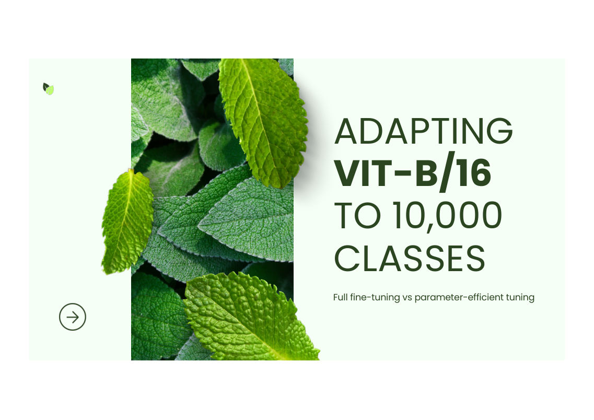
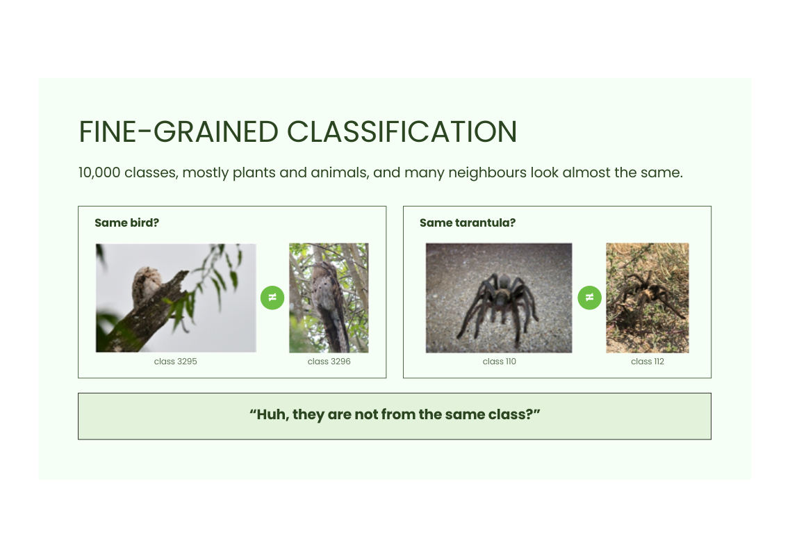
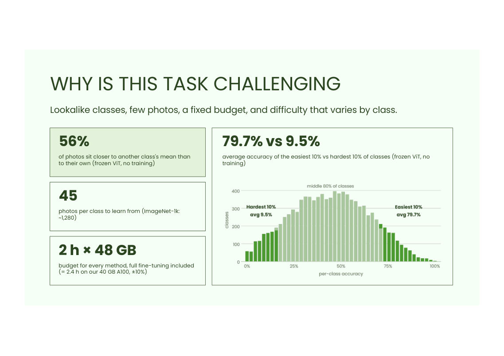
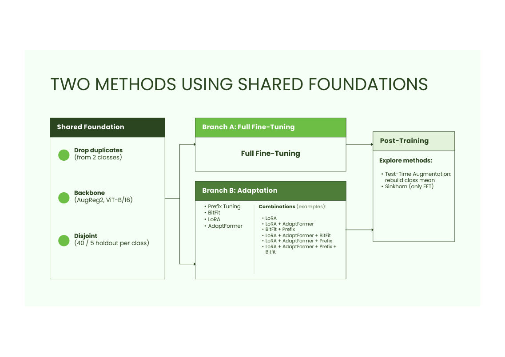
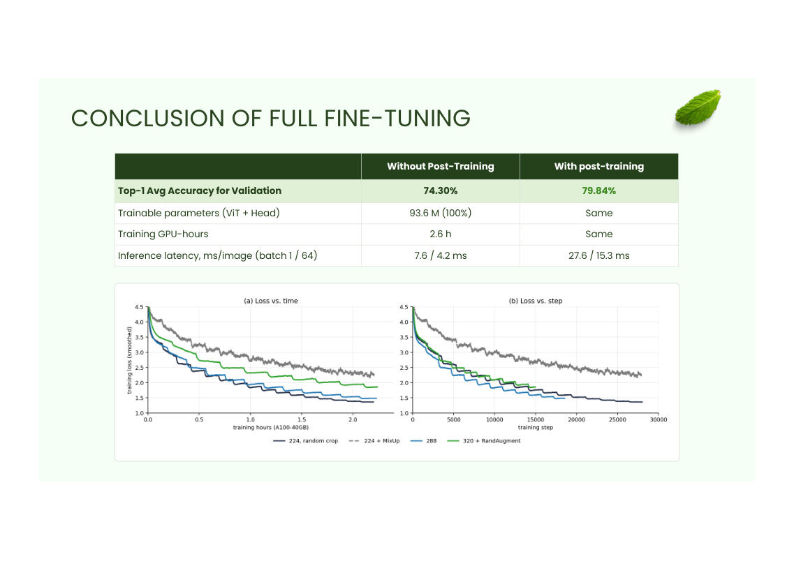
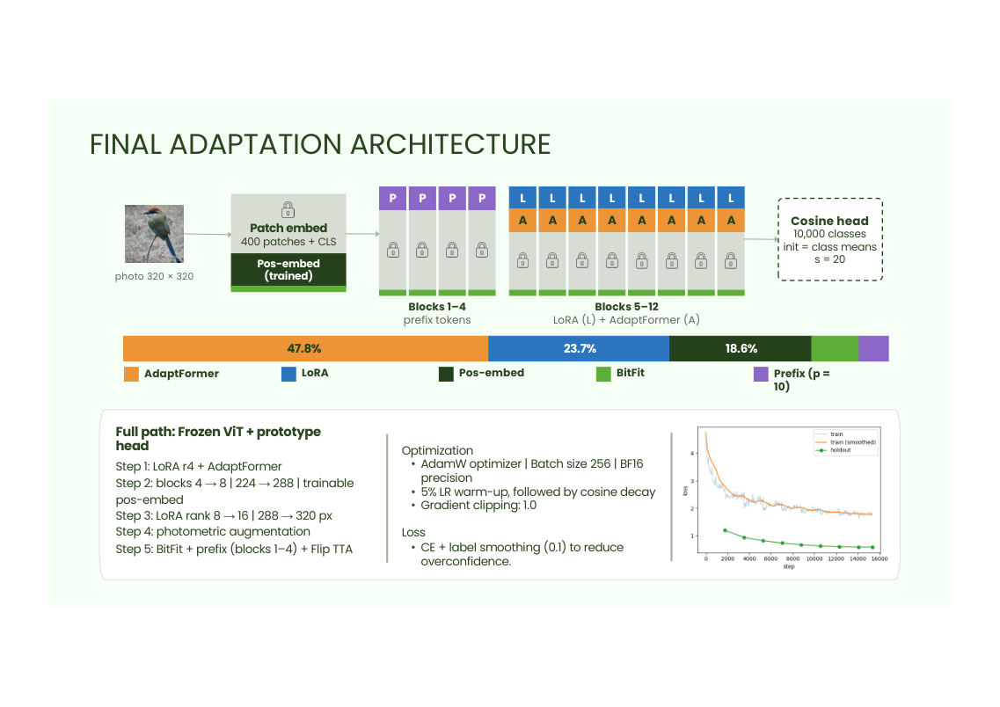

# Computer vision

Vision transformers, full fine-tuning, and parameter-efficient adaptation. 

## Fine-grained classification

We worked on a fine-grained classification task involving 10,000 classes, mostly plants and animals, with only 45 labelled training images per class. Many classes look almost identical, making it difficult for a pretrained model to distinguish between them.

A frozen Vision Transformer (ViT-B/16) provided a useful starting point, but its pretrained features were not enough. 56% of the training images were actually closer to another class's average feature representation than their own. There was also a wide gap in difficulty: the easiest 10% of classes achieved around 80% accuracy, while the hardest 10% scored only around 10%.

### Approach

With a training budget of approximately two GPU-hours, we explored two ways to adapt the pretrained model:
- Full fine-tuning (FFT): Updated all 93.6 million model parameters. We experimented with higher-resolution inputs and data augmentation to better capture fine-grained visual details. A two-resolution ensemble combined with a balanced assignment step achieved 79.84% validation accuracy.
- Parameter-efficient adaptation: Kept the backbone largely frozen, using Prefix Tuning, LoRA and AdaptFormer across different transformer blocks, with bias terms also trained. This required training only 1.66 million backbone parameters (1.93% of the backbone).

### Slides

