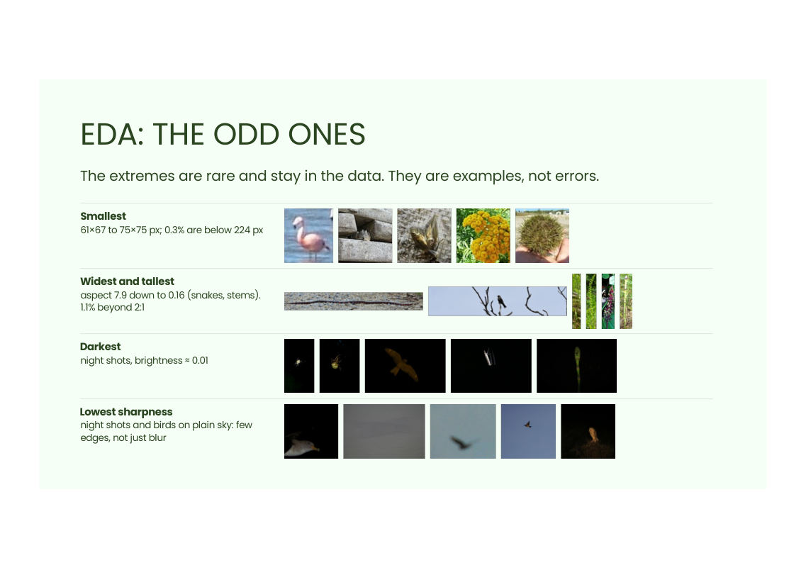
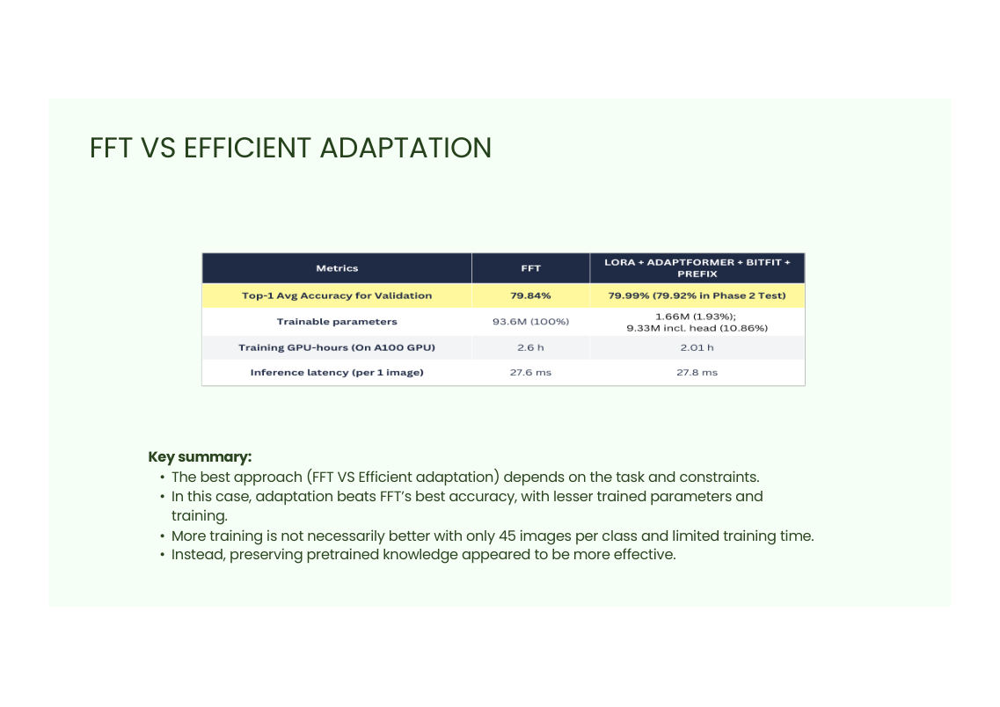

# Computer vision

Developed and compared full fine-tuning and parameter-efficient adaptation approaches for a 10,000-class image classification task using a pretrained Vision Transformer (ViT-B/16). With only 45 labelled images per class, distinguishing between visually similar categories was a key challenge.

- Problem analysis: Examined pretrained feature representations and found that 56% of training images were closer to another class's average representation than their own, highlighting the difficulty of fine-grained classification.

- Full fine-tuning: Updated all 93.6 million model parameters, experimenting with higher-resolution inputs and data augmentation. A two-resolution ensemble with balanced assignment achieved 79.84% validation accuracy.

- Parameter-efficient adaptation: Explored Prefix Tuning, LoRA and AdaptFormer across different transformer blocks, alongside trainable bias terms. The final approach trained only 1.66 million backbone parameters (1.93%), while keeping the remaining backbone weights frozen.

### Slides

<input type="radio" name="d6" id="d6-1" checked>
<input type="radio" name="d6" id="d6-2">
<input type="radio" name="d6" id="d6-3">
<input type="radio" name="d6" id="d6-4">
<input type="radio" name="d6" id="d6-5">
<input type="radio" name="d6" id="d6-6">
<input type="radio" name="d6" id="d6-7">
<input type="radio" name="d6" id="d6-8">

<label class="deck-arrow prev" for="d6-8" aria-label="Previous slide">&#8249;</label><label class="deck-arrow next" for="d6-2" aria-label="Next slide">&#8250;</label>

<label class="deck-arrow prev" for="d6-1" aria-label="Previous slide">&#8249;</label><label class="deck-arrow next" for="d6-3" aria-label="Next slide">&#8250;</label>

<label class="deck-arrow prev" for="d6-2" aria-label="Previous slide">&#8249;</label><label class="deck-arrow next" for="d6-4" aria-label="Next slide">&#8250;</label>

<label class="deck-arrow prev" for="d6-3" aria-label="Previous slide">&#8249;</label><label class="deck-arrow next" for="d6-5" aria-label="Next slide">&#8250;</label>

<label class="deck-arrow prev" for="d6-4" aria-label="Previous slide">&#8249;</label><label class="deck-arrow next" for="d6-6" aria-label="Next slide">&#8250;</label>

<label class="deck-arrow prev" for="d6-5" aria-label="Previous slide">&#8249;</label><label class="deck-arrow next" for="d6-7" aria-label="Next slide">&#8250;</label>

<label class="deck-arrow prev" for="d6-6" aria-label="Previous slide">&#8249;</label><label class="deck-arrow next" for="d6-8" aria-label="Next slide">&#8250;</label>

<label class="deck-arrow prev" for="d6-7" aria-label="Previous slide">&#8249;</label><label class="deck-arrow next" for="d6-1" aria-label="Next slide">&#8250;</label>

<label for="d6-1"></label>
<label for="d6-2"></label>
<label for="d6-3"></label>
<label for="d6-4"></label>
<label for="d6-5"></label>
<label for="d6-6"></label>
<label for="d6-7"></label>
<label for="d6-8"></label>

