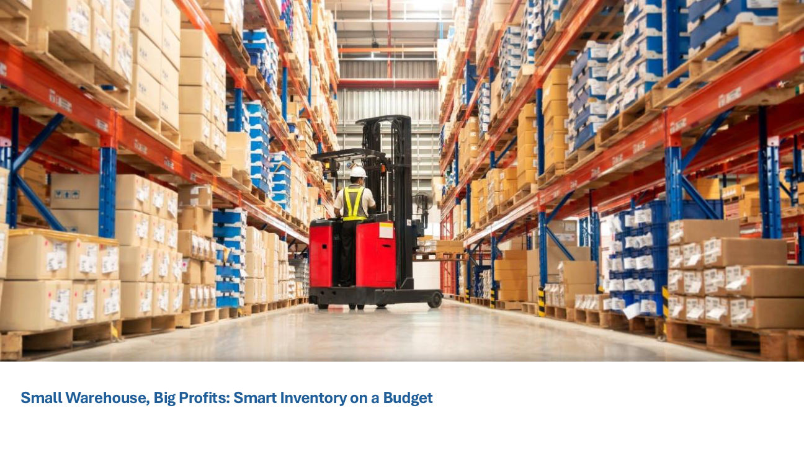
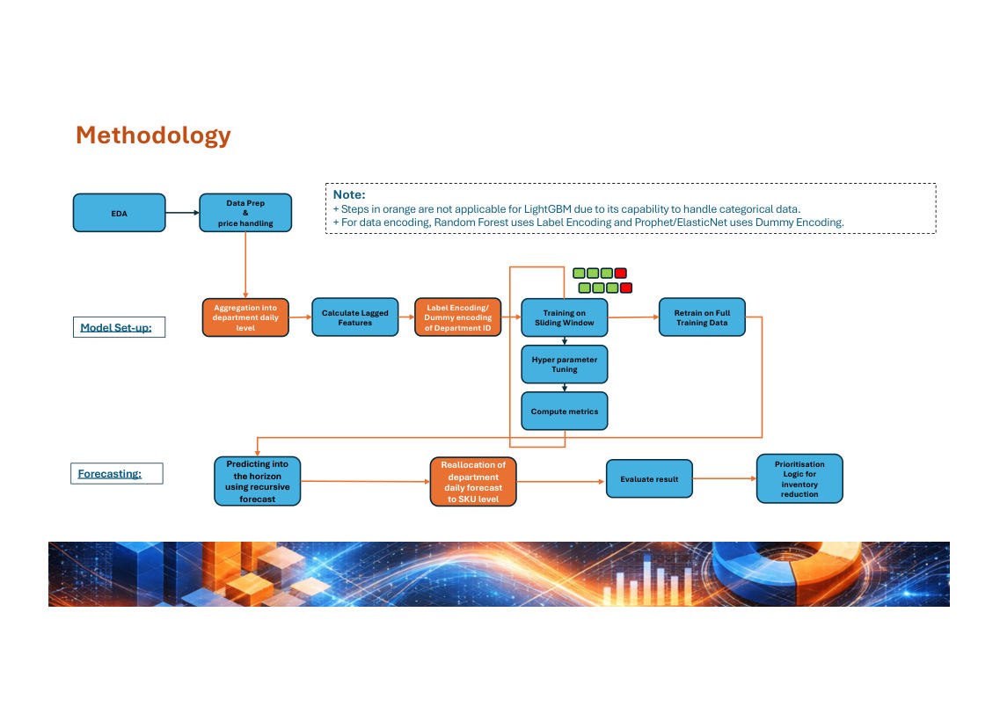
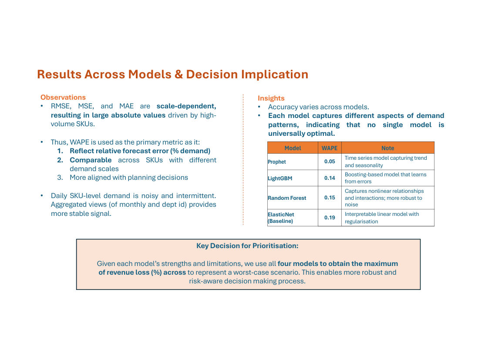
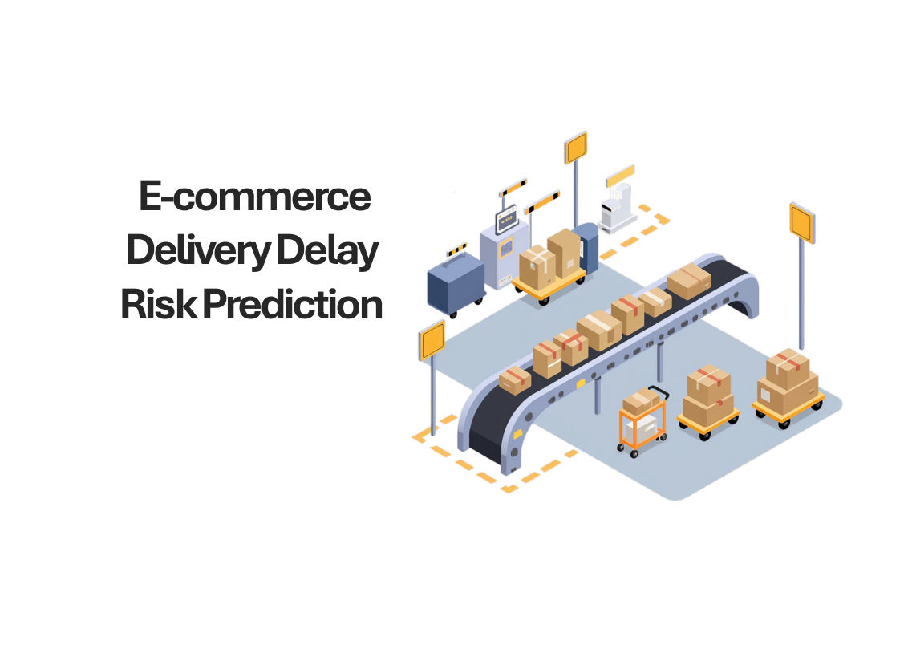
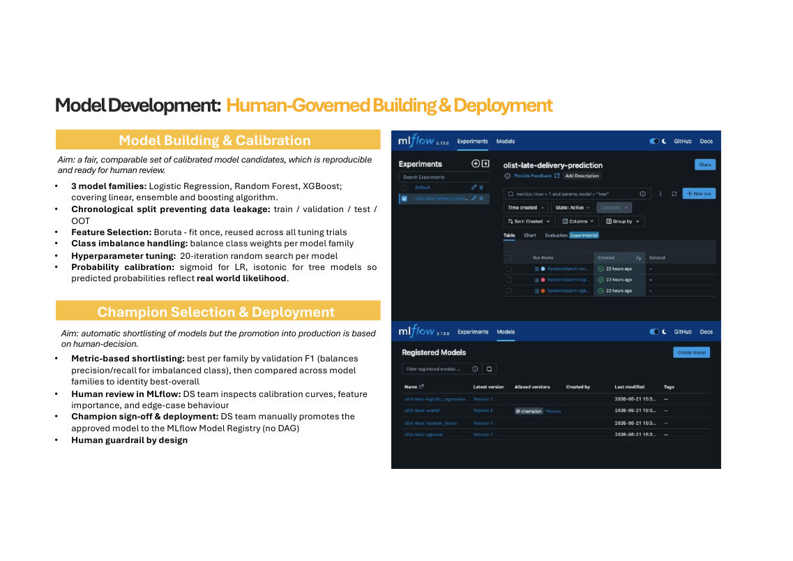
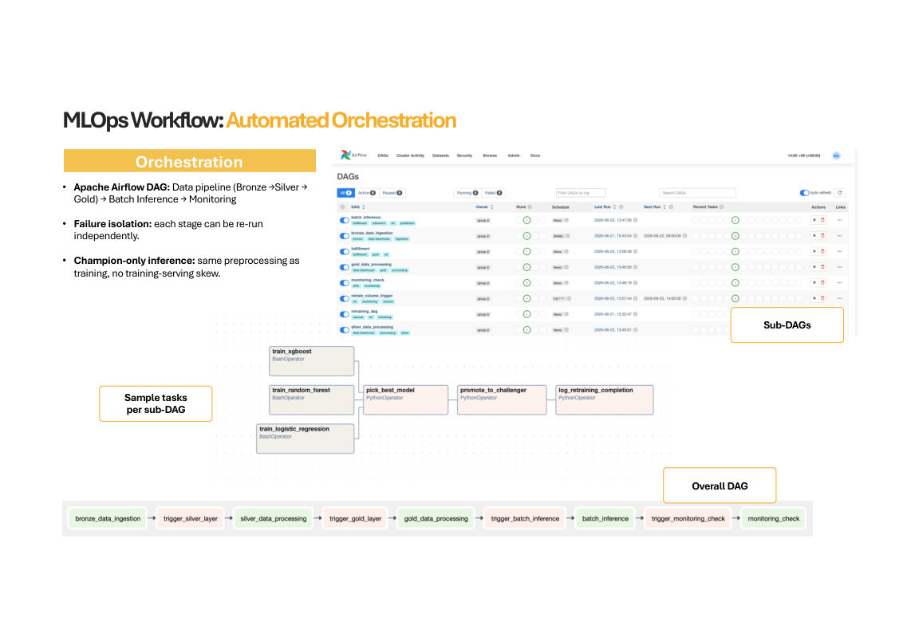

# Machine learning and data pipelines

Forecasting, classification and the engineering pipelines that take models beyond experimentation. 

## Demand forecasting under warehouse capacity constraints

A warehouse with limited space cannot stock every product. The challenge was to decide which SKUs to prioritise when storage capacity is reduced, while minimising potential revenue loss.

We used Walmart point-of-sale data from 2011–2016 to forecast daily demand. The dataset included calendar, holiday, SNAP and price information. Since many products have intermittent demand, we engineered lag and rolling-window features to capture changes in sales patterns rather than relying on daily averages.

### What we experimented with

- Features for intermittent demand: lags, rolling windows, weekday and weekend, and event type rather than one holiday flag. Inactive products were defined from the first observed price, so early years were not treated as true zero demand.
- Four forecasting models, scored on weighted absolute percentage error: Prophet, LightGBM, random forest, and an elastic net.
- A single forecast was not the decision rule. SKU priority used the most pessimistic revenue-loss estimate across the four models, then capacity was cut from 100% down in steps to see where the loss stayed flat and where it steepened.

### Slides

<input type="radio" name="d4" id="d4-1" checked>
<input type="radio" name="d4" id="d4-2">
<input type="radio" name="d4" id="d4-3">
<input type="radio" name="d4" id="d4-4">
<input type="radio" name="d4" id="d4-5">
<input type="radio" name="d4" id="d4-6">
<input type="radio" name="d4" id="d4-7">
<input type="radio" name="d4" id="d4-8">

<label class="deck-arrow prev" for="d4-8" aria-label="Previous slide">&#8249;</label><label class="deck-arrow next" for="d4-2" aria-label="Next slide">&#8250;</label>

<label class="deck-arrow prev" for="d4-1" aria-label="Previous slide">&#8249;</label><label class="deck-arrow next" for="d4-3" aria-label="Next slide">&#8250;</label>

<label class="deck-arrow prev" for="d4-2" aria-label="Previous slide">&#8249;</label><label class="deck-arrow next" for="d4-4" aria-label="Next slide">&#8250;</label>

<label class="deck-arrow prev" for="d4-3" aria-label="Previous slide">&#8249;</label><label class="deck-arrow next" for="d4-5" aria-label="Next slide">&#8250;</label>

<label class="deck-arrow prev" for="d4-4" aria-label="Previous slide">&#8249;</label><label class="deck-arrow next" for="d4-6" aria-label="Next slide">&#8250;</label>

<label class="deck-arrow prev" for="d4-5" aria-label="Previous slide">&#8249;</label><label class="deck-arrow next" for="d4-7" aria-label="Next slide">&#8250;</label>

<label class="deck-arrow prev" for="d4-6" aria-label="Previous slide">&#8249;</label><label class="deck-arrow next" for="d4-8" aria-label="Next slide">&#8250;</label>

<label class="deck-arrow prev" for="d4-7" aria-label="Previous slide">&#8249;</label><label class="deck-arrow next" for="d4-1" aria-label="Next slide">&#8250;</label>

<label for="d4-1"></label>
<label for="d4-2"></label>
<label for="d4-3"></label>
<label for="d4-4"></label>
<label for="d4-5"></label>
<label for="d4-6"></label>
<label for="d4-7"></label>
<label for="d4-8"></label>

## Late-delivery risk

Late deliveries affect both customer experience and logistics operations. The goal was to identify orders at risk of arriving late at dispatch time, giving the operations team an opportunity to expedite shipments or notify customers.

We used approximately 100,000 Olist orders from 2017–2018 to build a binary classification model predicting whether an order would arrive late or on time.

### What we experimented with

We built an end-to-end machine learning pipeline covering data preparation, model development, deployment selection and monitoring.

- Data pipeline: Stored raw data as an immutable copy, cleaned and transformed the source files, and created a shared feature table with the target label kept separate from model inputs.

- Model development: Trained and tuned Logistic Regression, Random Forest and XGBoost models, followed by probability calibration. Models were shortlisted based on validation F1.

- Model selection: Kept model promotion as a human decision rather than automatically deploying whichever model performed best during experimentation.

- Model monitoring: After each scoring run, checked F1 against the validation baseline, prediction drift, feature drift and whether enough new data had accumulated to justify retraining.

- Alerting and retraining: Generated alerts for the data team when monitoring checks indicated potential deterioration. Retraining remained a deliberate decision rather than an automatic response to every alert.

### Slides

<input type="radio" name="d5" id="d5-1" checked>
<input type="radio" name="d5" id="d5-2">
<input type="radio" name="d5" id="d5-3">
<input type="radio" name="d5" id="d5-4">
<input type="radio" name="d5" id="d5-5">
<input type="radio" name="d5" id="d5-6">
<input type="radio" name="d5" id="d5-7">
<input type="radio" name="d5" id="d5-8">
<input type="radio" name="d5" id="d5-9">

<label class="deck-arrow prev" for="d5-9" aria-label="Previous slide">&#8249;</label><label class="deck-arrow next" for="d5-2" aria-label="Next slide">&#8250;</label>

<label class="deck-arrow prev" for="d5-1" aria-label="Previous slide">&#8249;</label><label class="deck-arrow next" for="d5-3" aria-label="Next slide">&#8250;</label>

<label class="deck-arrow prev" for="d5-2" aria-label="Previous slide">&#8249;</label><label class="deck-arrow next" for="d5-4" aria-label="Next slide">&#8250;</label>

<label class="deck-arrow prev" for="d5-3" aria-label="Previous slide">&#8249;</label><label class="deck-arrow next" for="d5-5" aria-label="Next slide">&#8250;</label>

<label class="deck-arrow prev" for="d5-4" aria-label="Previous slide">&#8249;</label><label class="deck-arrow next" for="d5-6" aria-label="Next slide">&#8250;</label>

<label class="deck-arrow prev" for="d5-5" aria-label="Previous slide">&#8249;</label><label class="deck-arrow next" for="d5-7" aria-label="Next slide">&#8250;</label>

<label class="deck-arrow prev" for="d5-6" aria-label="Previous slide">&#8249;</label><label class="deck-arrow next" for="d5-8" aria-label="Next slide">&#8250;</label>

<label class="deck-arrow prev" for="d5-7" aria-label="Previous slide">&#8249;</label><label class="deck-arrow next" for="d5-9" aria-label="Next slide">&#8250;</label>

<label class="deck-arrow prev" for="d5-8" aria-label="Previous slide">&#8249;</label><label class="deck-arrow next" for="d5-1" aria-label="Next slide">&#8250;</label>

<label for="d5-1"></label>
<label for="d5-2"></label>
<label for="d5-3"></label>
<label for="d5-4"></label>
<label for="d5-5"></label>
<label for="d5-6"></label>
<label for="d5-7"></label>
<label for="d5-8"></label>
<label for="d5-9"></label>

