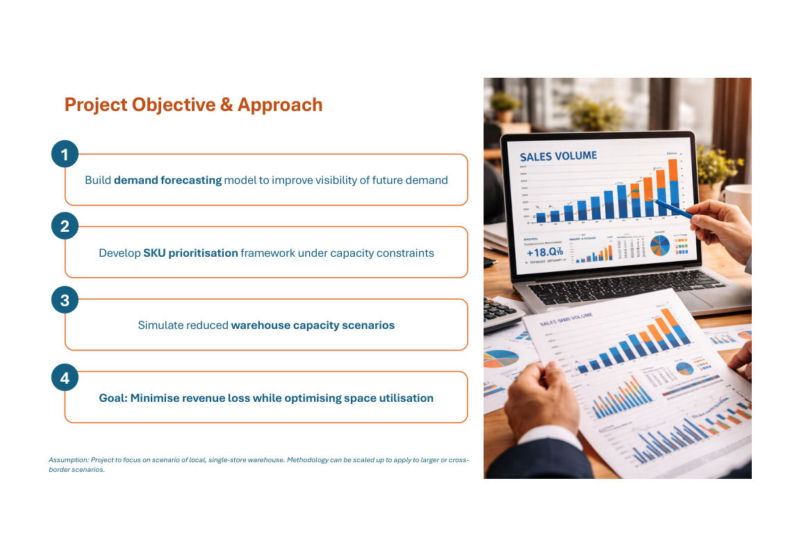
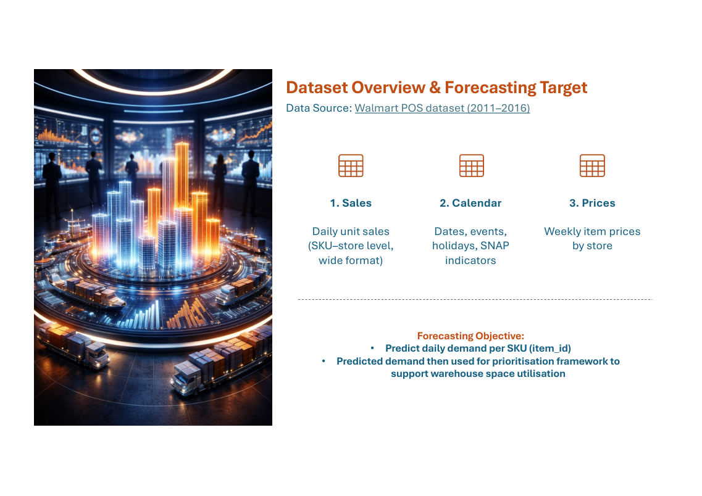
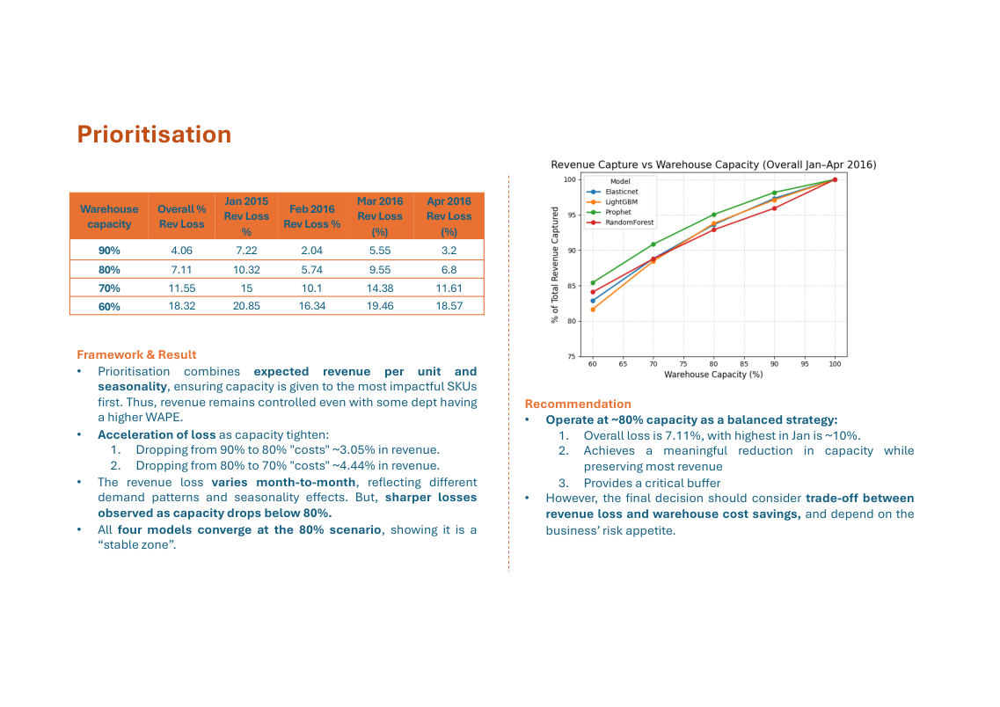
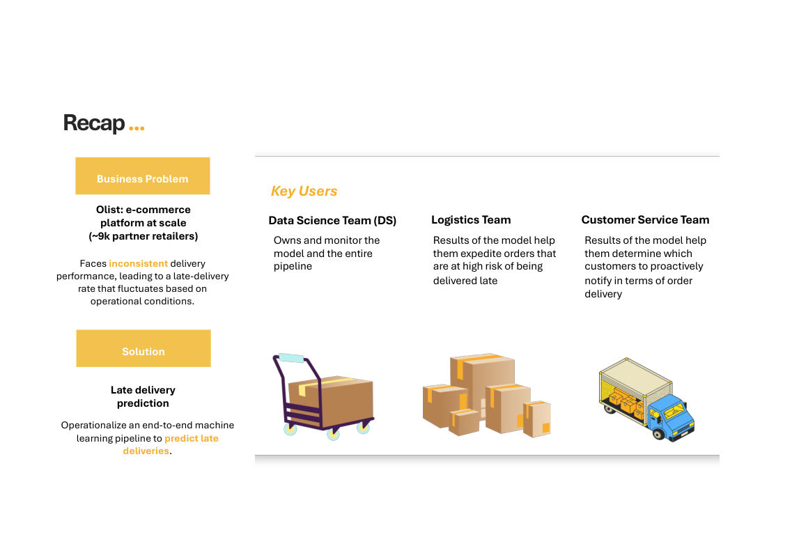
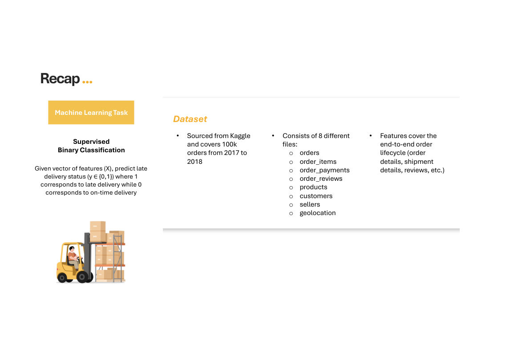
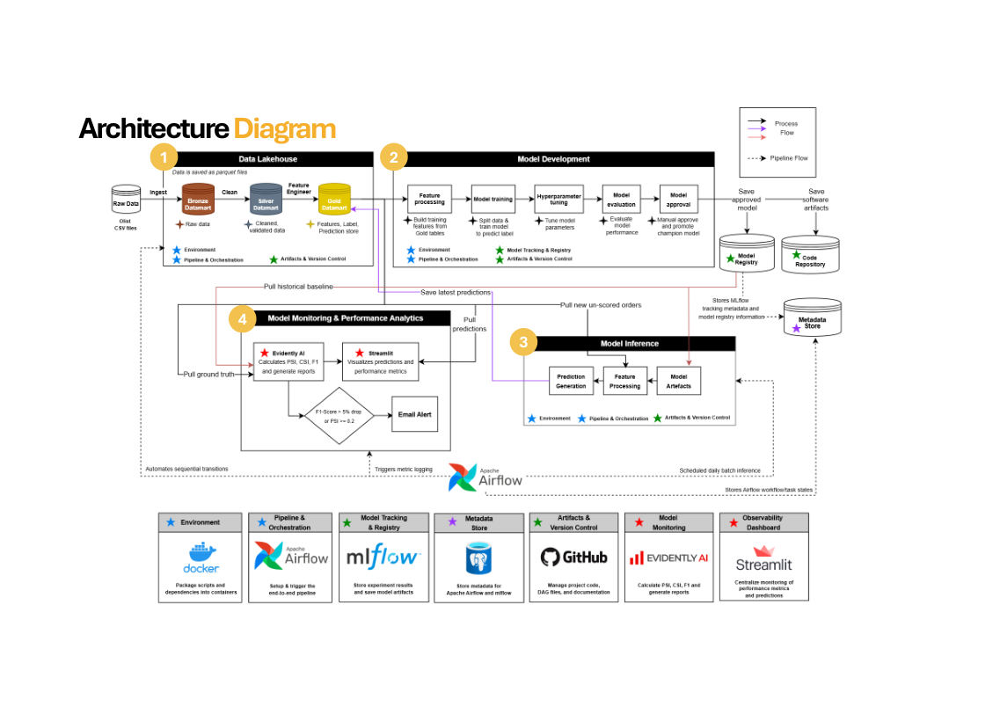
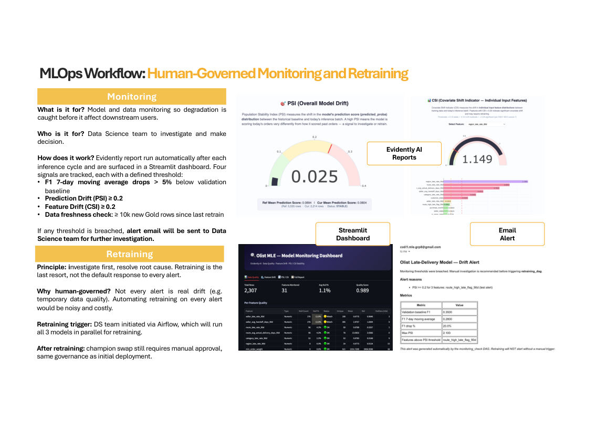
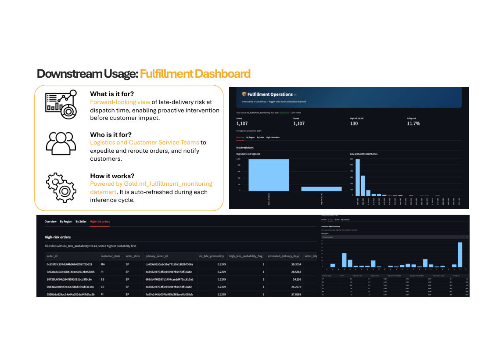
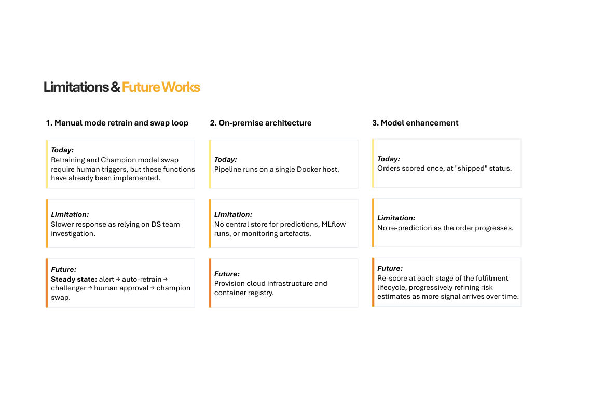

# Machine Learning & MLOps

## Demand forecasting under warehouse capacity constraints

How should a warehouse prioritise products when storage capacity is reduced, while minimising potential revenue loss?

Using Walmart point-of-sale data (2011–2016), developed daily demand forecasts and evaluated how different forecasting approaches could inform inventory allocation.

- Feature engineering: Developed lag, rolling-window, weekday, weekend and event-based features to capture intermittent demand patterns. Also accounted for product inactivity to avoid treating periods before a product became available as zero demand.

- Model comparison: Evaluated Prophet, LightGBM, Random Forest and Elastic Net using weighted absolute percentage error.

- Decision optimisation: Rather than relying on a single forecast, used the most pessimistic revenue-loss estimate across the four models to prioritise SKUs. Simulated progressive capacity reductions to identify where revenue loss began to increase significantly.

### Slides

<input type="radio" name="d4" id="d4-1" checked>
<input type="radio" name="d4" id="d4-2">
<input type="radio" name="d4" id="d4-3">
<input type="radio" name="d4" id="d4-4">
<input type="radio" name="d4" id="d4-5">
<input type="radio" name="d4" id="d4-6">
<input type="radio" name="d4" id="d4-7">
<input type="radio" name="d4" id="d4-8">

<label class="deck-arrow prev" for="d4-8" aria-label="Previous slide">&#8249;</label><label class="deck-arrow next" for="d4-2" aria-label="Next slide">&#8250;</label>

<label class="deck-arrow prev" for="d4-1" aria-label="Previous slide">&#8249;</label><label class="deck-arrow next" for="d4-3" aria-label="Next slide">&#8250;</label>

<label class="deck-arrow prev" for="d4-2" aria-label="Previous slide">&#8249;</label><label class="deck-arrow next" for="d4-4" aria-label="Next slide">&#8250;</label>

<label class="deck-arrow prev" for="d4-3" aria-label="Previous slide">&#8249;</label><label class="deck-arrow next" for="d4-5" aria-label="Next slide">&#8250;</label>

<label class="deck-arrow prev" for="d4-4" aria-label="Previous slide">&#8249;</label><label class="deck-arrow next" for="d4-6" aria-label="Next slide">&#8250;</label>

<label class="deck-arrow prev" for="d4-5" aria-label="Previous slide">&#8249;</label><label class="deck-arrow next" for="d4-7" aria-label="Next slide">&#8250;</label>

<label class="deck-arrow prev" for="d4-6" aria-label="Previous slide">&#8249;</label><label class="deck-arrow next" for="d4-8" aria-label="Next slide">&#8250;</label>

<label class="deck-arrow prev" for="d4-7" aria-label="Previous slide">&#8249;</label><label class="deck-arrow next" for="d4-1" aria-label="Next slide">&#8250;</label>

<label for="d4-1"></label>
<label for="d4-2"></label>
<label for="d4-3"></label>
<label for="d4-4"></label>
<label for="d4-5"></label>
<label for="d4-6"></label>
<label for="d4-7"></label>
<label for="d4-8"></label>

## Late-delivery risk

How can logistics teams identify orders at risk of late delivery early enough to take preventive action?

Using approximately 100,000 Olist orders (2017–2018), developed a binary classification system to predict late deliveries at dispatch time, supporting operational decisions such as shipment expediting and customer notifications.

- Data engineering: Built a reproducible pipeline for data cleaning, transformation and feature preparation, maintaining separate target labels and model inputs.

- Model development: Trained and tuned Logistic Regression, Random Forest and XGBoost models, followed by probability calibration. Shortlisted models based on validation F1.

- Deployment strategy: Incorporated human approval into model promotion rather than automatically deploying the highest-scoring experimental model.

- Monitoring and retraining: Tracked F1 against the validation baseline, prediction drift and feature drift. Generated alerts for potential model deterioration, with retraining triggered through deliberate review rather than automatically.

### Slides

<input type="radio" name="d5" id="d5-1" checked>
<input type="radio" name="d5" id="d5-2">
<input type="radio" name="d5" id="d5-3">
<input type="radio" name="d5" id="d5-4">
<input type="radio" name="d5" id="d5-5">
<input type="radio" name="d5" id="d5-6">
<input type="radio" name="d5" id="d5-7">
<input type="radio" name="d5" id="d5-8">
<input type="radio" name="d5" id="d5-9">

<label class="deck-arrow prev" for="d5-9" aria-label="Previous slide">&#8249;</label><label class="deck-arrow next" for="d5-2" aria-label="Next slide">&#8250;</label>

<label class="deck-arrow prev" for="d5-1" aria-label="Previous slide">&#8249;</label><label class="deck-arrow next" for="d5-3" aria-label="Next slide">&#8250;</label>

<label class="deck-arrow prev" for="d5-2" aria-label="Previous slide">&#8249;</label><label class="deck-arrow next" for="d5-4" aria-label="Next slide">&#8250;</label>

<label class="deck-arrow prev" for="d5-3" aria-label="Previous slide">&#8249;</label><label class="deck-arrow next" for="d5-5" aria-label="Next slide">&#8250;</label>

<label class="deck-arrow prev" for="d5-4" aria-label="Previous slide">&#8249;</label><label class="deck-arrow next" for="d5-6" aria-label="Next slide">&#8250;</label>

<label class="deck-arrow prev" for="d5-5" aria-label="Previous slide">&#8249;</label><label class="deck-arrow next" for="d5-7" aria-label="Next slide">&#8250;</label>

<label class="deck-arrow prev" for="d5-6" aria-label="Previous slide">&#8249;</label><label class="deck-arrow next" for="d5-8" aria-label="Next slide">&#8250;</label>

<label class="deck-arrow prev" for="d5-7" aria-label="Previous slide">&#8249;</label><label class="deck-arrow next" for="d5-9" aria-label="Next slide">&#8250;</label>

<label class="deck-arrow prev" for="d5-8" aria-label="Previous slide">&#8249;</label><label class="deck-arrow next" for="d5-1" aria-label="Next slide">&#8250;</label>

<label for="d5-1"></label>
<label for="d5-2"></label>
<label for="d5-3"></label>
<label for="d5-4"></label>
<label for="d5-5"></label>
<label for="d5-6"></label>
<label for="d5-7"></label>
<label for="d5-8"></label>
<label for="d5-9"></label>

