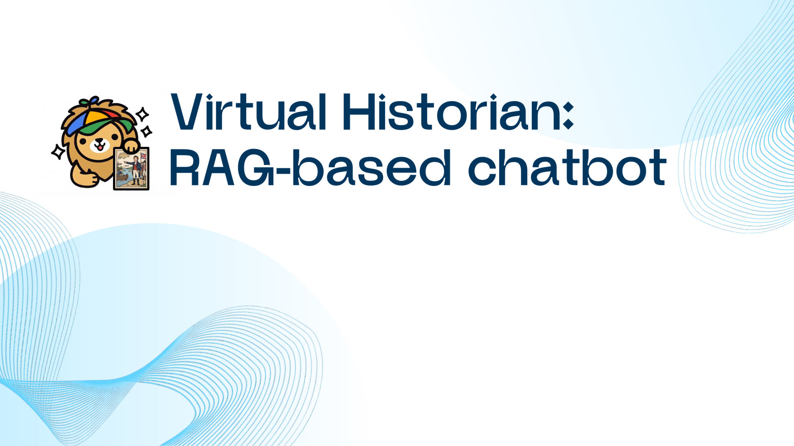
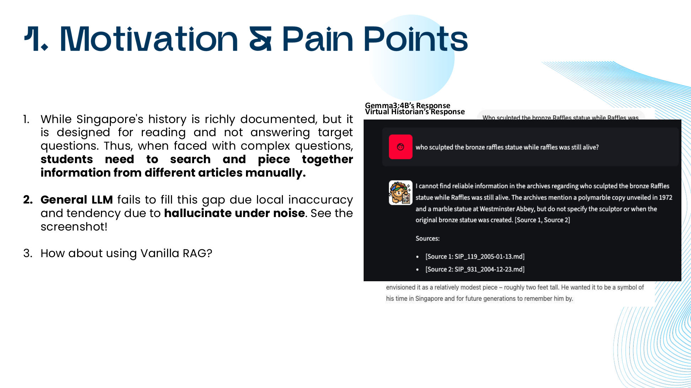
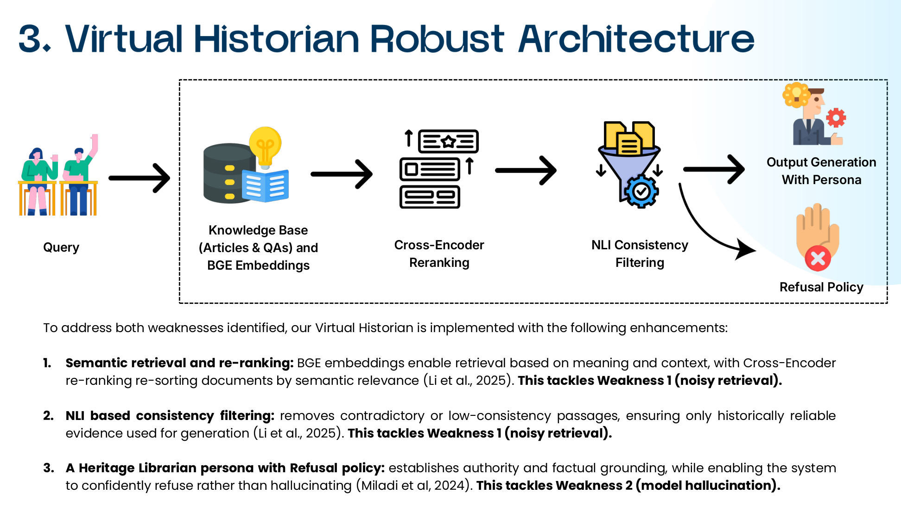
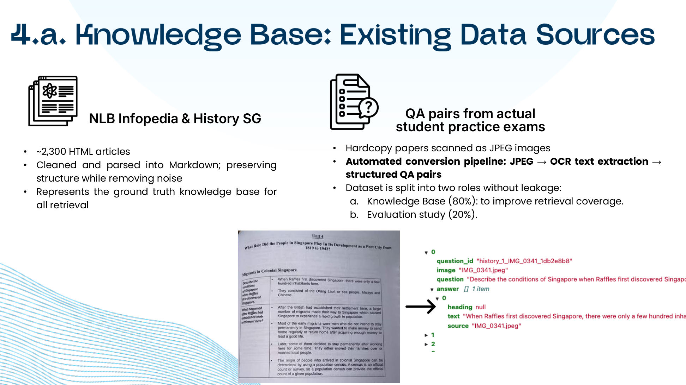
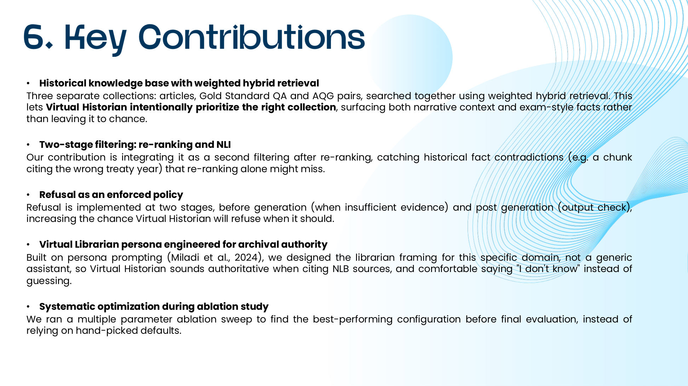

# Natural language processing

Retrieval over real-world documents, with a focus on making generated answers relevant, grounded and traceable to their sources.

## Virtual Historian

Singapore's history is documented across articles and historical resources, but finding reliable answers to specific questions requires more than a general-purpose chatbot.

A general language model can miss local context or invent details when it lacks reliable information. Basic retrieval-augmented generation (RAG) helps by bringing in relevant documents, but simply passing retrieved passages to a language model does not guarantee that the final answer is accurate or supported by those sources.

Virtual Historian is a question-answering system that retrieves information from Singapore history articles and checks the supporting evidence before generating an answer.

### Approach

We built the system around Gemma 3 4B and experimented with different retrieval and verification techniques:

- Chunking: Compared different document chunk sizes, with around 500 tokens providing the best results.

- Hybrid retrieval: Combined dense vector search with keyword search. This delivered the largest improvement in retrieval recall by capturing both semantic similarity and specific historical terms.

- Reranking: Reordered retrieved passages to prioritise those most relevant to the question.

- Consistency checking: Added a verification step to check whether the generated answer was consistent with the retrieved evidence.

- Source citation: Required answers to reference their supporting sources, making it easier to trace where information came from.

### Slides

