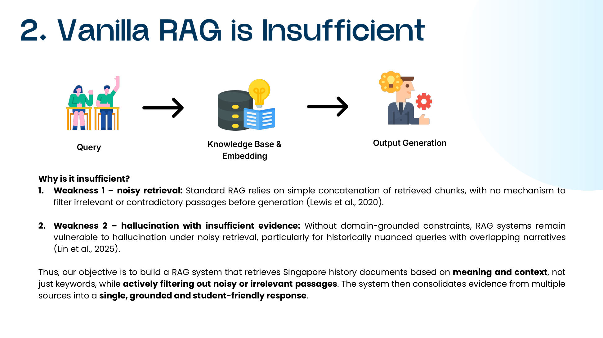
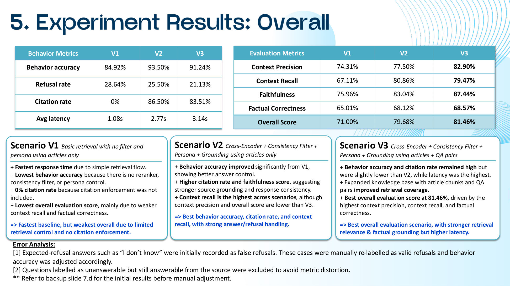
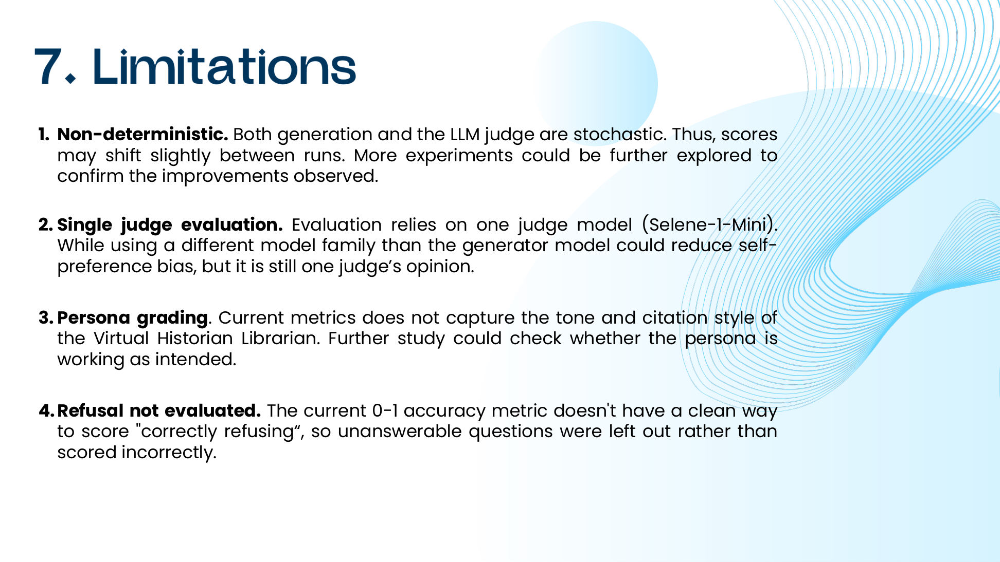

# Generative AI

## Virtual Historian

Singapore's history is documented across articles and historical resources, but finding reliable answers to specific questions requires more than a general-purpose chatbot.

Virtual Historian is a question-answering system that retrieves information from Singapore history articles and checks the supporting evidence before generating an answer. It is built by experimenting with different retrieval and verification techniques:

- Chunking: Compared different document chunk sizes, with around 500 tokens providing the best results.

- Hybrid retrieval: Combined dense vector search with keyword search. This delivered the largest improvement in retrieval recall by capturing both semantic similarity and specific historical terms.

- Reranking: Reordered retrieved passages to prioritise those most relevant to the question.

- Consistency checking: Added a verification step to check whether the generated answer was consistent with the retrieved evidence.

- Source citation: Required answers to reference their supporting sources, making it easier to trace where information came from.

### Slides

<input type="radio" name="d3" id="d3-1" checked>
<input type="radio" name="d3" id="d3-2">
<input type="radio" name="d3" id="d3-3">
<input type="radio" name="d3" id="d3-4">
<input type="radio" name="d3" id="d3-5">
<input type="radio" name="d3" id="d3-6">
<input type="radio" name="d3" id="d3-7">
<input type="radio" name="d3" id="d3-8">
<input type="radio" name="d3" id="d3-9">

<label class="deck-arrow prev" for="d3-9" aria-label="Previous slide">&#8249;</label><label class="deck-arrow next" for="d3-2" aria-label="Next slide">&#8250;</label>

<label class="deck-arrow prev" for="d3-1" aria-label="Previous slide">&#8249;</label><label class="deck-arrow next" for="d3-3" aria-label="Next slide">&#8250;</label>

<label class="deck-arrow prev" for="d3-2" aria-label="Previous slide">&#8249;</label><label class="deck-arrow next" for="d3-4" aria-label="Next slide">&#8250;</label>

<label class="deck-arrow prev" for="d3-3" aria-label="Previous slide">&#8249;</label><label class="deck-arrow next" for="d3-5" aria-label="Next slide">&#8250;</label>

<label class="deck-arrow prev" for="d3-4" aria-label="Previous slide">&#8249;</label><label class="deck-arrow next" for="d3-6" aria-label="Next slide">&#8250;</label>

<label class="deck-arrow prev" for="d3-5" aria-label="Previous slide">&#8249;</label><label class="deck-arrow next" for="d3-7" aria-label="Next slide">&#8250;</label>

<label class="deck-arrow prev" for="d3-6" aria-label="Previous slide">&#8249;</label><label class="deck-arrow next" for="d3-8" aria-label="Next slide">&#8250;</label>

<label class="deck-arrow prev" for="d3-7" aria-label="Previous slide">&#8249;</label><label class="deck-arrow next" for="d3-9" aria-label="Next slide">&#8250;</label>

<label class="deck-arrow prev" for="d3-8" aria-label="Previous slide">&#8249;</label><label class="deck-arrow next" for="d3-1" aria-label="Next slide">&#8250;</label>

<label for="d3-1"></label>
<label for="d3-2"></label>
<label for="d3-3"></label>
<label for="d3-4"></label>
<label for="d3-5"></label>
<label for="d3-6"></label>
<label for="d3-7"></label>
<label for="d3-8"></label>
<label for="d3-9"></label>

